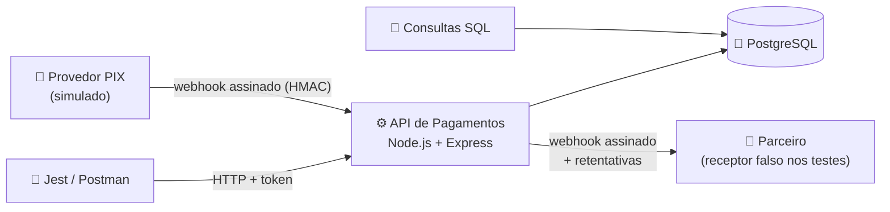
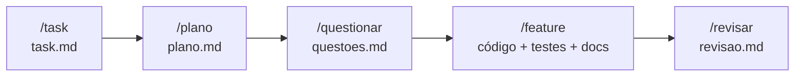

<div align="center">

# 🧪 QA Lab — API de Pagamentos

**Laboratório de testes de API e integrações: uma carteira digital fictícia com PIX via webhook,
transferências idempotentes, estornos e notificações para parceiros, coberta por uma suíte completa
de testes automatizados.**

[](https://github.com/QApedroHenrique/qa-lab-api-pagamentos/actions/workflows/testes.yml)


[**📊 Ver relatórios de teste**](https://QApedroHenrique.github.io/qa-lab-api-pagamentos/) ·
[**📚 Documentação**](#-documentação) ·
[**🤖 Fluxo com IA**](#-desenvolvimento-assistido-por-ia-claude-code) ·
[**▶️ Como rodar**](#️-como-rodar)

</div>

---

## 👀 Em 30 segundos

| | |
|---|---|
| **O que é** | Uma API de pagamentos **fictícia**, criada do zero como sistema sob teste, e toda a estratégia de QA em volta dela |
| **Testes automatizados** | **183 testes** (110 casos documentados) em Jest: funcionais, contrato, segurança, concorrência e validação SQL |
| **Regressão Postman** | **21 requisições encadeadas / 114 asserções**, rodando pelo Newman |
| **Qualidade dos testes** | **8 de 8 bugs inseridos de propósito foram detectados** ([teste de mutação](docs/relatorio-de-execucao.md#teste-de-mutação-manual)) |
| **Documentação** | Plano de teste, regras de negócio, casos com rastreabilidade, arquitetura, OpenAPI + Swagger |
| **CI/CD** | GitHub Actions a cada push: Postgres real, Jest, Newman, checagem de rastreabilidade e relatórios publicados |

---

## 💼 Por que este projeto existe

Este projeto mostra, com **dados e regras 100% fictícios**, o tipo de trabalho que fiz como QA:
testar **APIs e integrações entre sistemas**, onde um bug pode virar cobrança em dobro, dinheiro
creditado sem existir ou dado pessoal vazado.

| Na minha experiência como QA, atuei com… | Onde isso aparece neste projeto |
|---|---|
| Testes de **APIs REST e integrações** com parceiros externos (Postman e Insomnia) | Suíte Jest em [`tests/`](tests) e coleção em [`postman/`](postman) |
| Validação de **webhooks**: tipos de evento, payload, status HTTP e reenvios | [Webhook de entrada (PIX)](tests/funcional/webhook-pix.test.js) e [webhooks de saída](tests/funcional/webhooks-saida.test.js) |
| **Regressão de backend encadeada no Postman** (login → depósito → saque) | [Coleção encadeada](postman/qa-lab-api-pagamentos.postman_collection.json): token → contas → PIX → transferência → estorno → extrato |
| **Suíte automatizada de testes de webhooks** em Node.js + Jest + Ajv | Mesma stack usada aqui, com [validação de contrato](tests/helpers/contrato.js) pelo OpenAPI |
| **SQL para investigar bugs** e conferir se o dado gravado bate com a resposta da API | [Consultas de consistência](sql/consistencia) executadas pelos [testes de dados](tests/dados/consistencia.test.js) |
| Abertura e acompanhamento de **bugs e tarefas no Jira**, com critério de aceite e evidência | [Casos de teste](docs/casos-de-teste.md) com regra, técnica e prioridade, e [relatório de execução](docs/relatorio-de-execucao.md) |

> 🔒 **Confidencialidade:** nenhum código, dado, endpoint, nome ou regra de empresas em que trabalhei foi
> usado aqui. A API, os dados e as regras foram inventados para este portfólio.

---

## 🎯 O que é testado

| Área | Testes | Destaques |
|---|---:|---|
| Autenticação | 15 | JWT adulterado, expirado, outro segredo, ataque `alg: none` |
| Contas | 22 | CPF por partição de equivalência, nome por valor-limite, duplicidade |
| Extrato | 11 | Ordem dos lançamentos, limite de paginação (0/1/100/101) |
| Transferências | 28 | Valor-limite (0, 1, R$ 10.000,00, +1 centavo), tabela de decisão |
| Idempotência | 6 | Mesma chave = mesma resposta e débito único, conferido via SQL |
| Estornos | 7 | Transição de estado, estorno duplicado, destino sem saldo |
| Webhook de entrada (PIX) | 20 | Assinatura HMAC, corpo adulterado, replay (5 min), evento repetido |
| Webhooks de saída | 17 | Payload, assinatura, **retentativas com 500/503**, parceiro fora do ar |
| Contrato (OpenAPI) | 13 | Toda resposta validada contra o `openapi.yaml`, a mesma doc publicada |
| Segurança | 32 | Rotas protegidas, **LGPD (CPF nunca exposto)**, SQL injection, **SSRF**, segredos em produção |
| Concorrência | 5 | **10 transferências simultâneas**, mesma chave em paralelo, deadlock |
| Dados (SQL) | 7 | Saldo × livro-razão, conservação do dinheiro, PIX creditado uma vez |
| **Total** | **183** | |

---

## ✨ Destaques técnicos

<details>
<summary><b>Idempotência de verdade, inclusive com requisições simultâneas</b></summary>

Se o cliente reenviar a mesma transferência (timeout, retry automático, clique duplo), a API devolve a
**mesma resposta** e **não debita de novo**. A chave é gravada no início da transação: se 5 requisições
com a mesma chave chegarem juntas, só uma transferência é criada (CT-CNC-02, confirmado com SQL).
</details>

<details>
<summary><b>Testes de concorrência que pegam gasto duplo</b></summary>

10 transferências de R$ 1,00 disparadas **ao mesmo tempo** numa conta com R$ 5,00: exatamente 5 passam e o
saldo nunca fica negativo (CT-CNC-01). No teste de mutação, removi o lock do banco e **só os testes de
concorrência perceberam**. Testes sequenciais passariam com esse bug.
</details>

<details>
<summary><b>Segurança de webhook com HMAC</b></summary>

O PIX recebido só é aceito com assinatura HMAC-SHA256 válida. Os testes cobrem: sem assinatura, segredo
errado, **corpo alterado depois de assinado (valor inflado)**, assinatura vencida (proteção contra replay)
e header mal formado. A assinatura dos testes foi implementada de forma independente da API, como um oráculo separado.
</details>

<details>
<summary><b>Contrato como fonte única da verdade</b></summary>

As respostas são validadas contra os schemas do próprio [`openapi.yaml`](openapi/openapi.yaml), com o
matcher customizado `expect(corpo).toSeguirContrato('Conta')`. Se a API devolver um campo a mais (como o
CPF completo), o teste de contrato falha. A documentação publicada em `/docs` é o mesmo arquivo.
</details>

<details>
<summary><b>Validação de dados com SQL</b></summary>

Depois de um cenário com PIX, transferências, estorno e reenvio de evento, consultas SQL conferem que o
saldo de toda conta bate com o livro-razão, que nenhum saldo é negativo e que **a soma de todos os saldos é
igual à soma dos PIX recebidos** (dinheiro não é criado nem destruído).
</details>

<details>
<summary><b>Documentação que não fica desatualizada</b></summary>

Todo teste tem um ID (`[CT-TRF-05]`) que aparece no [catálogo de casos](docs/casos-de-teste.md). Um script no
CI (`npm run docs:verificar`) **quebra o pipeline** se existir teste sem documentação ou caso documentado sem teste.
</details>

<details>
<summary><b>Revisão externa aplicada e limitações assumidas</b></summary>

Uma revisão externa da arquitetura apontou riscos reais. Os pequenos e testáveis viraram regra e teste:
a API **não inicia em produção com segredo padrão** (CT-SEG-11/12), o cadastro de webhook **bloqueia SSRF**
para rede interna e metadados da nuvem (CT-SEG-13), além de índices em FKs, ROLLBACK protegido, trava contra
`TRUNCATE` em banco não local e esperas por condição no lugar de `sleep`. O que exige mudança de arquitetura
(outbox para webhooks, autorização por recurso/BOLA, TTL de idempotência, migrações versionadas) está em
[**Limitações conhecidas e próximos passos**](docs/arquitetura.md#7-limitações-conhecidas-e-próximos-passos),
com o risco concreto e como cada item seria testado.
</details>

---

## 🏗️ Arquitetura



Detalhes, modelo de dados e diagramas de sequência em [**docs/arquitetura.md**](docs/arquitetura.md).

---

## ▶️ Como rodar

**Pré-requisitos:** Node.js 20+ e Docker.

```bash
git clone https://github.com/QApedroHenrique/qa-lab-api-pagamentos.git
cd qa-lab-api-pagamentos

docker compose up -d db   # PostgreSQL
npm install
npm test                  # sobe a API, limpa o banco e roda os 183 testes
```

| Comando | O que faz |
|---|---|
| `npm test` | Suíte completa (relatório em `reports/jest/index.html`) |
| `npx jest -t "CT-IDE"` | Só um grupo de casos (ex.: idempotência) |
| `npm start` | Sobe a API em `http://localhost:3000` (Swagger em **`/docs`**) |
| `npm run test:newman` | Regressão Postman (com a API rodando) |
| `npm run docs:verificar` | Confere a rastreabilidade testes × documentação |

Passo a passo completo, Postman pela interface e solução de problemas: [**docs/guia-de-execucao.md**](docs/guia-de-execucao.md).

---

## 🤖 Desenvolvimento assistido por IA (Claude Code)

Em vez de um prompt enorme com tudo de uma vez, cada mudança passa por **skills em camadas**
([`.claude/skills/`](.claude/skills)), executadas como comandos `/` no Claude Code dentro do VS Code.
Cada etapa tem um papel só, gera um artefato em `.claude/tasks/<slug>/` e a próxima parte dele:
menos contexto repetido, menos "invenção" e mais rastreabilidade.



| Skill | Papel | O que garante |
|---|---|---|
| [`/task`](.claude/skills/task/SKILL.md) | Especificar | Pedido solto vira regra com valores exatos (centavos, status, código de erro) e critérios de aceite |
| [`/plano`](.claude/skills/plano/SKILL.md) | Planejar | Arquivos, passos, casos de teste com ID/técnica ISTQB e checagem dos riscos de pagamento |
| [`/questionar`](.claude/skills/questionar/SKILL.md) | QA cético | **Não concorda por padrão**: aponta o que não foi validado (valor-limite, concorrência, idempotência, LGPD, contrato) antes do código existir |
| [`/feature`](.claude/skills/feature/SKILL.md) | Implementar | Segue o plano, escreve testes e docs, roda `npm test` e `docs:verificar` |
| [`/revisar`](.claude/skills/revisar/SKILL.md) | Revisar | Confere critérios de aceite, regras de pagamento, segurança e rastreabilidade, com veredito |

O [`CLAUDE.md`](CLAUDE.md) dá o contexto fixo do projeto (stack, comandos e regras que não podem ser quebradas).

---

## 📚 Documentação

| Documento | Conteúdo |
|---|---|
| [Plano de teste](docs/plano-de-teste.md) | Escopo, abordagem, técnicas, riscos, critérios de entrada e saída |
| [Regras de negócio](docs/regras-de-negocio.md) | Requisitos RN-01 a RN-16 (a base dos testes) |
| [Casos de teste](docs/casos-de-teste.md) | 107 casos com regra, técnica (ISTQB), prioridade e matriz de cobertura |
| [Relatório de execução](docs/relatorio-de-execucao.md) | Resultados, teste de mutação e riscos residuais |
| [Arquitetura](docs/arquitetura.md) | Componentes, modelo de dados, fluxos e decisões técnicas |
| [Referência da API](docs/referencia-da-api.md) | Endpoints, catálogo de erros, headers e exemplos com `curl` |
| [Guia de execução](docs/guia-de-execucao.md) | Como rodar local, com Docker, no Postman e no CI |
| [Glossário](docs/glossario.md) | Termos técnicos explicados de forma simples |
| [OpenAPI](openapi/openapi.yaml) | Especificação completa (também navegável em `/docs`) |

---

## 🗂️ Estrutura

```
├── src/                  # API fictícia (sistema sob teste)
├── openapi/              # contrato OpenAPI 3.1 (documentação + validação dos testes)
├── tests/
│   ├── funcional/        # auth, contas, extrato, transferências, idempotência, estornos, webhooks
│   ├── contrato/         # respostas × OpenAPI
│   ├── seguranca/        # acesso, LGPD, entradas maliciosas
│   ├── concorrencia/     # condições de corrida
│   ├── dados/            # integridade via SQL
│   ├── helpers/          # cliente HTTP, fábricas de dados, HMAC, receptor de webhook
│   └── setup/            # sobe a API, limpa o banco, matcher de contrato
├── postman/              # coleção encadeada + ambiente
├── sql/                  # consultas de consistência e de investigação
├── docs/                 # documentação de teste
├── scripts/              # rastreabilidade e página de relatórios
├── .claude/skills/       # fluxo de IA: task → plano → questionar → feature → revisar
└── .github/workflows/    # pipeline de CI
```

## 🛠️ Stack

**Testes:** Jest · axios · Ajv (JSON Schema 2020-12) · Postman · Newman · jest-html-reporters · newman-reporter-htmlextra<br/>
**API (sistema sob teste):** Node.js · Express 5 · PostgreSQL 16 · JWT · OpenAPI 3.1 · Swagger UI<br/>
**Infra:** Docker Compose · GitHub Actions · GitHub Pages

---

## 👤 Autor

**Pedro Henrique Barbosa dos Santos** — QA

[](https://www.linkedin.com/in/pedro-henrique-996aa7355/)

Distribuído sob a licença [MIT](LICENSE).
