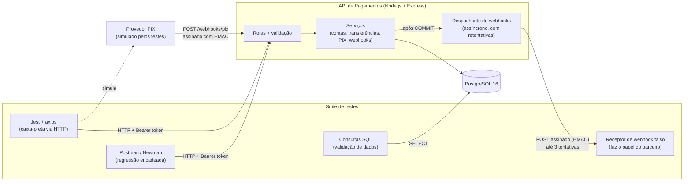
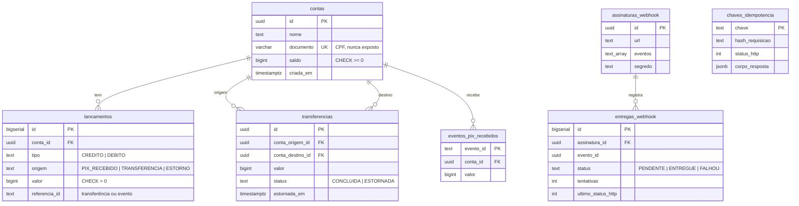
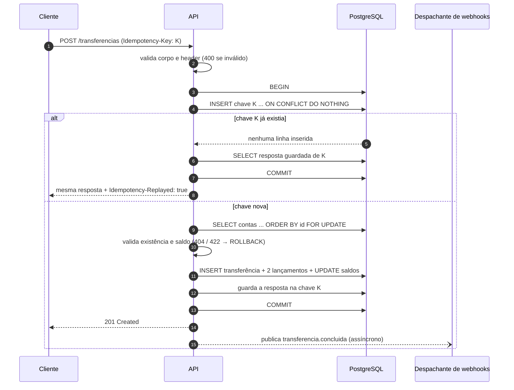
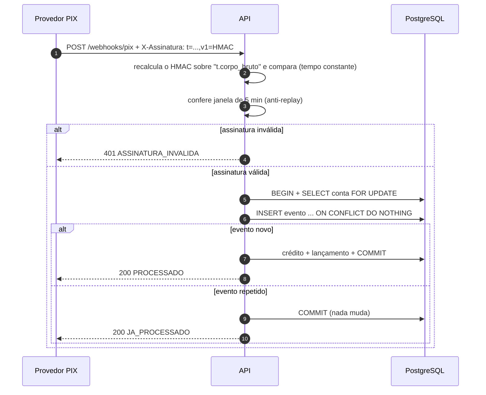
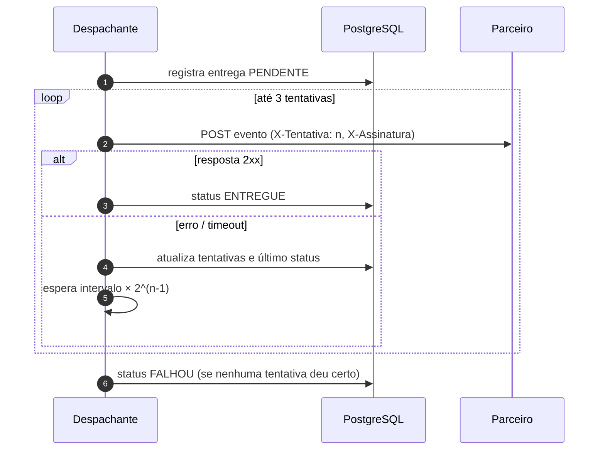

# Arquitetura

Visão técnica da API fictícia (o **sistema sob teste**) e da **arquitetura da automação**.

## 1. Visão geral



## 2. Estrutura do código

```
src/
├── app.js                 # monta o Express: X-Request-Id, JSON, rotas, Swagger, erros
├── server.js              # aplica o schema e sobe o servidor
├── config.js              # todas as configurações (via variáveis de ambiente)
├── db/
│   ├── schema.sql         # tabelas, constraints e índices
│   ├── migrate.js         # aplica o schema / limpa o banco (testes)
│   └── pool.js            # conexão e helper de transação (BEGIN/COMMIT/ROLLBACK)
├── middlewares/           # autenticação JWT e tratamento padronizado de erros
├── rotas/                 # validação de entrada e códigos HTTP
├── servicos/              # regras de negócio e acesso ao banco
└── utils/                 # CPF, assinatura HMAC, validações, erros
```

**Separação de responsabilidades:** as **rotas** validam a entrada e escolhem o status HTTP;
os **serviços** aplicam as regras de negócio dentro de transações; os **utils** são funções puras.

## 3. Modelo de dados



**Livro-razão (ledger):** o saldo fica em `contas.saldo` por desempenho, mas **toda** alteração gera
um lançamento. Isso permite auditar o saldo com SQL a qualquer momento
([`sql/consistencia/01_saldo_bate_com_lancamentos.sql`](../sql/consistencia/01_saldo_bate_com_lancamentos.sql)).

## 4. Fluxos principais

### 4.1 Transferência com idempotência



### 4.2 PIX recebido (webhook de entrada)



### 4.3 Webhook de saída com retentativas



## 5. Decisões técnicas

| Decisão | Motivo | Como é testado |
|---|---|---|
| Valores em **centavos inteiros** (`BIGINT`) | Evita erro de arredondamento de ponto flutuante | CT-TRF-10, CT-TRF-11 |
| **Chave de idempotência gravada no início da transação** | Requisições simultâneas com a mesma chave esperam a primeira terminar e recebem a mesma resposta | CT-CNC-02 |
| **`SELECT ... FOR UPDATE` em ordem fixa (por id)** | Impede gasto duplo e evita deadlock em A→B / B→A simultâneos | CT-CNC-01, CT-CNC-04 |
| **`CHECK (saldo >= 0)` no banco** | Defesa em profundidade: mesmo com bug na aplicação, o banco recusa saldo negativo | CT-DAD-02 |
| **HMAC sobre `timestamp.corpo_bruto`** | Garante autenticidade e integridade, e impede reaproveitar requisições antigas | CT-PIX-06 a 13 |
| **Comparação em tempo constante** (`timingSafeEqual`) | Evita ataque de tempo na verificação de assinatura e credenciais | — (boa prática de código) |
| **Webhook disparado após o COMMIT** | Nunca notificar uma operação que foi desfeita | CT-WHK-02, CT-WHK-06 |
| **Entrega assíncrona com backoff exponencial** | Parceiro lento ou fora do ar não afeta o cliente | CT-WHK-07 a 09 |
| **CPF só mascarado nas respostas** | LGPD: minimização de dados | CT-SEG-02, CT-SEG-03 |
| **OpenAPI como fonte única do contrato** | A documentação publicada é a mesma usada para validar as respostas nos testes | CT-CTR-01 a 05 |

## 6. Arquitetura da automação

```
tests/
├── setup/            # global-setup (sobe a API e limpa o banco), teardown e matcher toSeguirContrato
├── helpers/          # cliente HTTP, fábricas de dados, assinatura HMAC, receptor de webhook, SQL
├── funcional/        # testes por funcionalidade
├── contrato/         # validação contra o OpenAPI
├── seguranca/        # autenticação, LGPD, entradas maliciosas
├── concorrencia/     # condições de corrida
└── dados/            # integridade via SQL
```

**Princípios usados:**

- **Caixa-preta:** os testes só conversam com a API por HTTP (`BASE_URL`). Dá para apontar a mesma
  suíte para outro ambiente sem mudar código.
- **Oráculo independente:** a assinatura HMAC dos testes foi escrita a partir da documentação, sem
  importar o código da API — se a API mudar o algoritmo por engano, o teste percebe.
- **Dados isolados e descartáveis:** cada teste cria as próprias contas com CPFs fictícios
  (fábricas em `tests/helpers/fabricas.js`). Nenhum teste depende de outro.
- **Status sempre explícito:** o cliente HTTP não lança exceção em 4xx/5xx; cada teste afirma o status esperado.
- **Espera por condição, não por tempo fixo:** o receptor de webhook espera até a requisição chegar
  (com timeout), o que deixa os testes rápidos e estáveis.
- **Matcher customizado:** `expect(corpo).toSeguirContrato('Conta')` deixa o teste legível e mostra
  exatamente qual campo violou o contrato quando falha.
