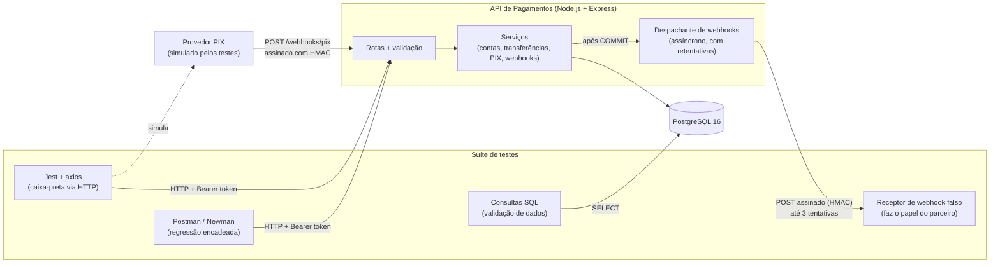
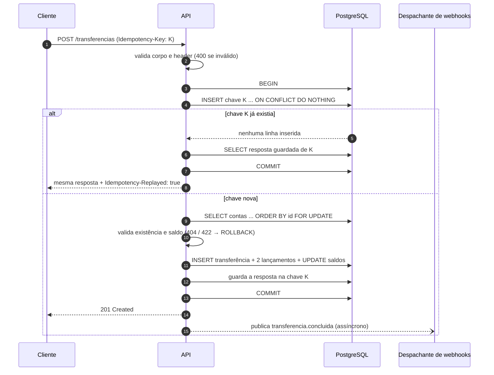
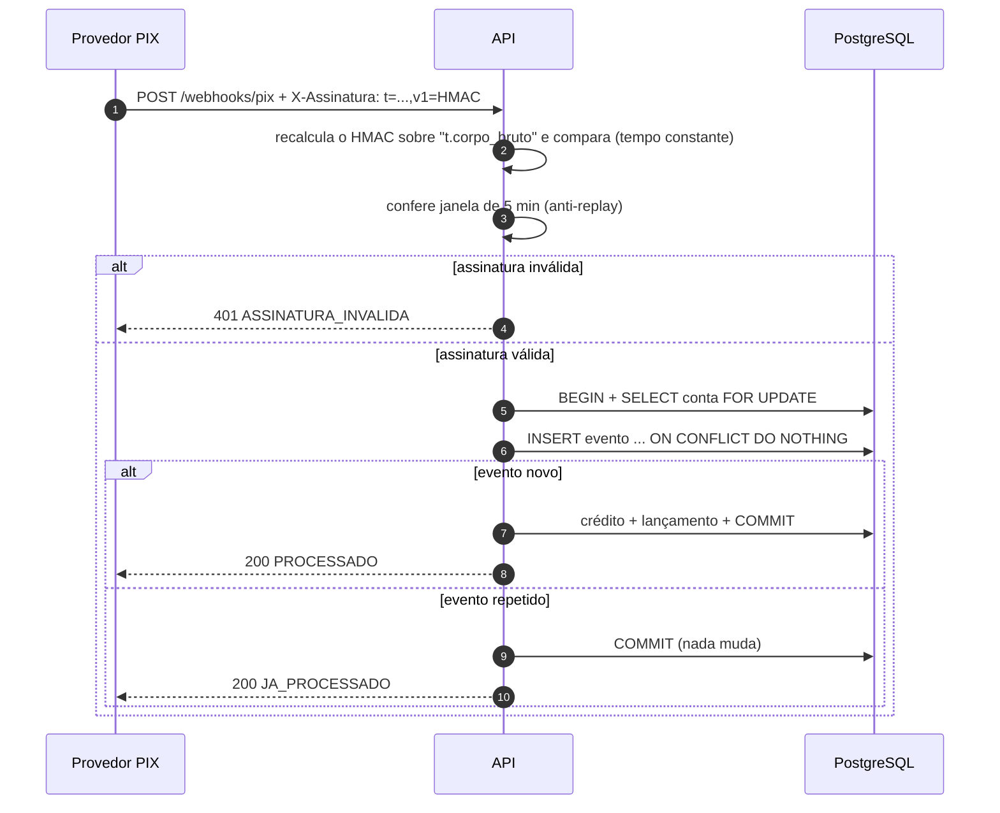
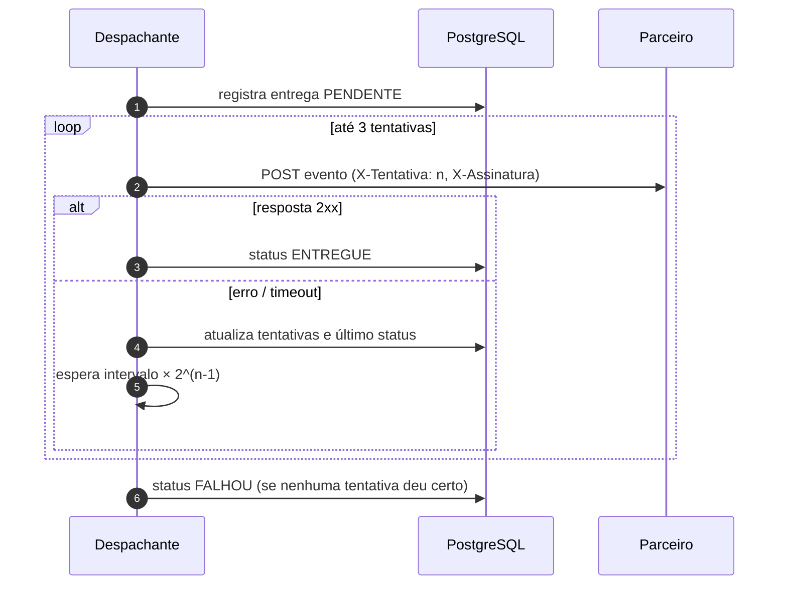
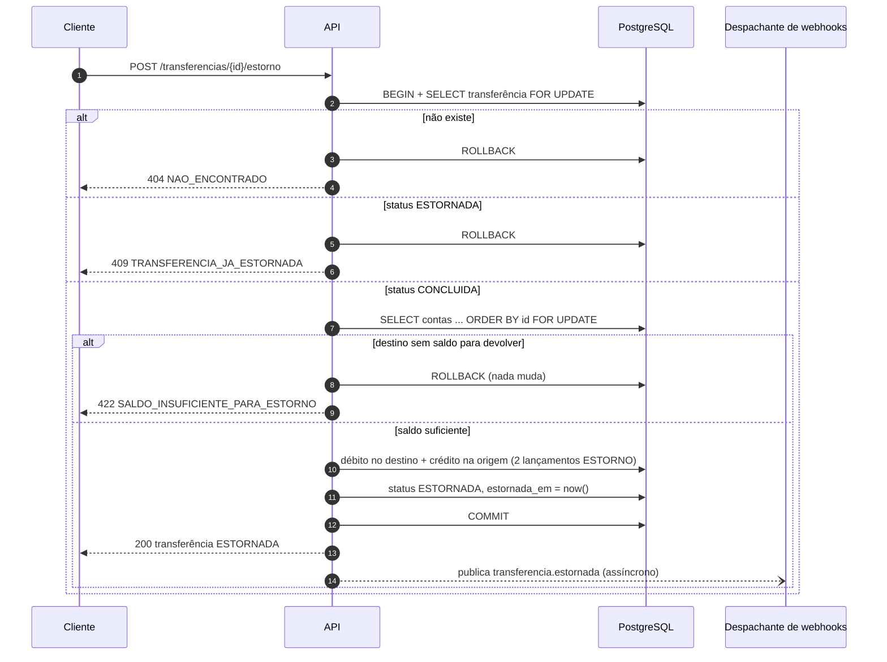

# Arquitetura

Visão técnica da API fictícia (o **sistema sob teste**) e da **arquitetura da automação**.

## 1. Visão geral



## 2. Estrutura do código

```
src/
├── app.js                 # monta o Express: X-Request-Id, JSON, rotas, Swagger, erros
├── server.js              # aplica o schema e sobe o servidor
├── config.js              # todas as configurações (via variáveis de ambiente)
├── db/
│   ├── schema.sql         # tabelas, constraints e índices
│   ├── migrate.js         # aplica o schema / limpa o banco (testes)
│   └── pool.js            # conexão e helper de transação (BEGIN/COMMIT/ROLLBACK)
├── middlewares/           # autenticação JWT e tratamento padronizado de erros
├── rotas/                 # validação de entrada e códigos HTTP
├── servicos/              # regras de negócio e acesso ao banco
└── utils/                 # CPF, assinatura HMAC, validações, erros
```

**Separação de responsabilidades:** as **rotas** validam a entrada e escolhem o status HTTP;
os **serviços** aplicam as regras de negócio dentro de transações; os **utils** são funções puras.

## 3. Modelo de dados

> **Diagrama simplificado:** mostra chaves e colunas de regra de negócio. Colunas como `descricao`,
> `ativa`, `tipo_evento`, `payload` e os timestamps de criação/atualização estão só no
> [`schema.sql`](../src/db/schema.sql), que é a fonte da verdade.


**Livro-razão (ledger):** o saldo fica em `contas.saldo` por desempenho, mas **toda** alteração gera
um lançamento. Isso permite auditar o saldo com SQL a qualquer momento
([`sql/consistencia/01_saldo_bate_com_lancamentos.sql`](../sql/consistencia/01_saldo_bate_com_lancamentos.sql)).

**Referência polimórfica:** `lancamentos.referencia_id` é `TEXT` **sem FK** porque aponta para tabelas
diferentes conforme a `origem`: `transferencias.id` (UUID) em `TRANSFERENCIA`/`ESTORNO` e
`eventos_pix_recebidos.evento_id` em `PIX_RECEBIDO`. A integridade dessa ligação não é garantida pelo
banco; ela é verificada pelas consultas de consistência (CT-DAD-04, CT-DAD-05).

**Índices:** além das PKs/UNIQUE, há índice em `lancamentos(conta_id, id DESC)` (extrato),
`transferencias(conta_origem_id)`, `transferencias(conta_destino_id)` e `entregas_webhook(assinatura_id, id DESC)`.
O Postgres não cria índice automático para chave estrangeira.

## 4. Fluxos principais

### 4.1 Transferência com idempotência



### 4.2 PIX recebido (webhook de entrada)



### 4.3 Webhook de saída com retentativas



### 4.4 Estorno



O `FOR UPDATE` na transferência serializa dois estornos simultâneos: o segundo espera, lê `ESTORNADA`
e recebe 409 (CT-CNC-03).

## 5. Decisões técnicas

| Decisão | Motivo | Como é testado |
|---|---|---|
| Valores em **centavos inteiros** (`BIGINT`) | Evita erro de arredondamento de ponto flutuante | CT-TRF-10, CT-TRF-11 |
| **Chave de idempotência gravada no início da transação** | Requisições simultâneas com a mesma chave esperam a primeira terminar e recebem a mesma resposta | CT-CNC-02 |
| **`SELECT ... FOR UPDATE` em ordem fixa (por id)** | Impede gasto duplo e evita deadlock em A→B / B→A simultâneos | CT-CNC-01, CT-CNC-04 |
| **`CHECK (saldo >= 0)` no banco** | Defesa em profundidade: mesmo com bug na aplicação, o banco recusa saldo negativo | CT-DAD-02 |
| **HMAC sobre `timestamp.corpo_bruto`** | Garante autenticidade e integridade, e impede reaproveitar requisições antigas | CT-PIX-06 a 13 |
| **Comparação em tempo constante** (`timingSafeEqual`) | Evita ataque de tempo na verificação de assinatura e credenciais | — (boa prática de código) |
| **Webhook disparado após o COMMIT** | Nunca notificar uma operação que foi desfeita | CT-WHK-02, CT-WHK-06 |
| **Entrega assíncrona com backoff exponencial** | Parceiro lento ou fora do ar não afeta o cliente | CT-WHK-07 a 09 |
| **CPF só mascarado nas respostas** | LGPD: minimização de dados | CT-SEG-02, CT-SEG-03 |
| **OpenAPI como fonte única do contrato** | A documentação publicada é a mesma usada para validar as respostas nos testes | CT-CTR-01 a 05 |
| **Produção não inicia com segredo padrão** | Os segredos locais estão no repositório: com eles, qualquer um forjaria tokens | CT-SEG-11, CT-SEG-12 |
| **Bloqueio de destino interno nos webhooks** | A API faz requisições para a URL do parceiro; sem bloqueio, viraria proxy para a rede interna (SSRF) | CT-SEG-13 |
| **ROLLBACK protegido em `emTransacao`** | Falha no ROLLBACK não esconde o erro original e a conexão quebrada é descartada do pool | — (revisão de código) |
| **Trava no `limparBanco()`** | O setup dos testes faz `TRUNCATE`: só roda em banco local ou com `PERMITIR_LIMPEZA_BANCO=true` | — (proteção da suíte) |

## 6. Arquitetura da automação

```
tests/
├── setup/            # global-setup (sobe a API e limpa o banco), teardown e matcher toSeguirContrato
├── helpers/          # cliente HTTP, fábricas de dados, assinatura HMAC, receptor de webhook, SQL
├── funcional/        # testes por funcionalidade
├── contrato/         # validação contra o OpenAPI
├── seguranca/        # autenticação, LGPD, entradas maliciosas
├── concorrencia/     # condições de corrida
└── dados/            # integridade via SQL
```

**Princípios usados:**

- **Caixa-preta:** os testes só conversam com a API por HTTP (`BASE_URL`). Dá para apontar a mesma
  suíte para outro ambiente sem mudar código.
- **Oráculo independente:** a assinatura HMAC dos testes foi escrita a partir da documentação, sem
  importar o código da API — se a API mudar o algoritmo por engano, o teste percebe.
- **Dados isolados e descartáveis:** cada teste cria as próprias contas com CPFs fictícios
  (fábricas em `tests/helpers/fabricas.js`). Nenhum teste depende de outro.
- **Status sempre explícito:** o cliente HTTP não lança exceção em 4xx/5xx; cada teste afirma o status esperado.
- **Espera por condição, não por tempo fixo:** o receptor de webhook espera até a requisição chegar e
  `aguardarAte()` consulta a API até o status da entrega mudar (com timeout), o que deixa os testes
  rápidos e estáveis.
  **Exceção consciente:** para provar que algo **não** aconteceu (CT-WHK-05, 06 e 10: "nenhum webhook
  chegou"), não existe condição para esperar; esses casos usam uma janela fixa curta (400–500 ms).
  O risco é de falso positivo (o evento chegar depois da janela), não de teste instável.
- **Matcher customizado:** `expect(corpo).toSeguirContrato('Conta')` deixa o teste legível e mostra
  exatamente qual campo violou o contrato quando falha.

## 7. Limitações conhecidas e próximos passos

Saber onde o sistema falha faz parte da estratégia de teste. Os itens abaixo vieram de uma revisão
externa da arquitetura e foram **conscientemente deixados de fora** desta versão: cada um muda a
arquitetura e merece uma tarefa própria. Os pontos da mesma revisão que eram pequenos e testáveis já
foram corrigidos (RN-15, RN-16, índices, `emTransacao`, trava do `limparBanco()` e esperas por condição).

| # | Limitação | Risco concreto | Próximo passo | Como seria testado |
|---|---|---|---|---|
| 1 | **Webhook de saída publicado em memória** depois do COMMIT | Se o processo cair entre o COMMIT e o `INSERT` em `entregas_webhook`, o evento some. Se cair no meio das retentativas, a entrega fica `PENDENTE` para sempre. "Nunca notificar algo desfeito" é garantido, mas "sempre notificar algo confirmado" **não** é | *Transactional outbox*: gravar a entrega na **mesma transação** da transferência e um *worker* processa as `PENDENTE` (inclusive as órfãs após reinício) | Matar o processo entre COMMIT e entrega; subir de novo e esperar a entrega chegar |
| 2 | **Sem autorização por recurso** (BOLA, nº 1 do OWASP API Top 10) | Qualquer token válido lê qualquer conta, estorna qualquer transferência e apaga qualquer assinatura. A `Idempotency-Key` é global, quando deveria ser única por `(cliente, chave)` | Dono (`client_id`) em contas, transferências e assinaturas; filtro por dono em toda consulta; PK `(client_id, chave)` | Segundo cliente de teste: 404 ao acessar recurso do outro; mesma chave em clientes diferentes gera duas transferências |
| 3 | **Anti-SSRF sem resolução de DNS** | Um domínio público que **resolve** para IP interno (ou *DNS rebinding*) passa pela checagem, que olha só o hostname | Resolver o DNS no cadastro **e** de novo na entrega, bloqueando IP interno; desativar redirecionamentos no `fetch` | Domínio de teste apontando para `127.0.0.1` |
| 4 | **Chaves de idempotência não expiram** | A tabela cresce sem limite; uma chave reaproveitada meses depois ainda devolve a resposta antiga | TTL (ex.: 24 h) e rotina de limpeza; documentar a janela no contrato | Chave com `criada_em` antiga é aceita como nova |
| 5 | **Migrações não versionadas** (`CREATE TABLE IF NOT EXISTS` no start) | Uma coluna nova em tabela existente **nunca** é aplicada; várias instâncias subindo juntas aplicam o schema em paralelo | `node-pg-migrate` (ou similar) com migrações numeradas, executadas como passo de deploy, fora do start | CI aplica as migrações do zero e a partir da versão anterior |
| 6 | **Sem *rate limit*** em `/auth/token` | Força bruta no `client_secret` | Limite por IP/cliente com 429 e `Retry-After` | N tentativas erradas → 429 |
| 7 | **Extrato sem paginação por cursor** (só `limite`) | Lançamentos antigos ficam inacessíveis | Cursor opaco baseado em `id` (`?depois_de=`) | Percorrer todas as páginas e conferir soma com o saldo |
| 8 | **Logs não estruturados** (`console`) | `X-Request-Id` só aparece no log de erro 500; difícil correlacionar uma requisição | Logger JSON (ex.: pino) com `request_id` em toda linha | Teste de log: o `X-Request-Id` aparece no log da requisição |
