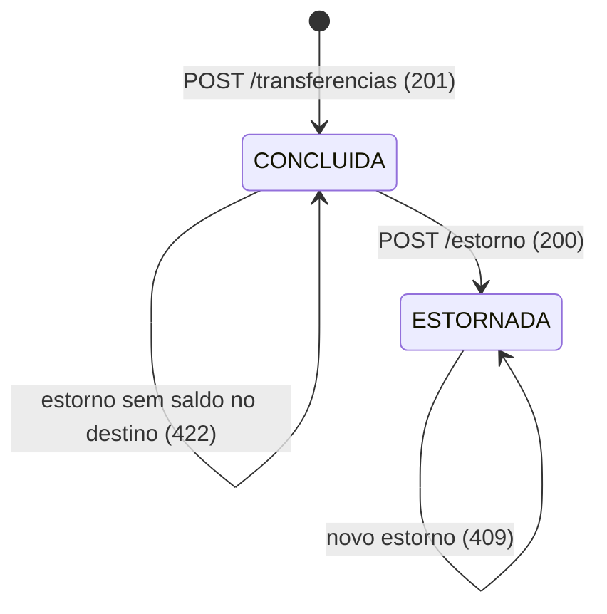

# Regras de negócio

Requisitos da API de Pagamentos (fictícia). Cada regra tem um identificador (`RN-XX`) que é
referenciado nos [casos de teste](casos-de-teste.md), garantindo rastreabilidade
**requisito → caso de teste → teste automatizado**.

> Todos os valores monetários são **inteiros em centavos**: `1050` = R$ 10,50.

---

## RN-01 — Autenticação

- Todas as rotas exigem `Authorization: Bearer <token>`, **exceto**: `GET /saude`, `POST /auth/token`,
  `POST /webhooks/pix` (que usa assinatura HMAC), `GET /docs` e `GET /openapi.json`.
- O token é obtido em `POST /auth/token` com `client_id` e `client_secret` (fluxo *client credentials*).
- O token é um JWT assinado com **HS256** e expira em **1 hora** (`expires_in: 3600`).
- Tokens ausentes, mal formados, adulterados, assinados com outro segredo, com algoritmo `none` ou
  expirados são recusados com **401 `NAO_AUTENTICADO`** e header `WWW-Authenticate`.
- Credenciais erradas retornam **401 `CREDENCIAIS_INVALIDAS`**. A resposta do token tem `Cache-Control: no-store`.

## RN-02 — Cadastro de conta

| Campo | Regra |
|---|---|
| `nome` | Texto de **3 a 100 caracteres**. Espaços no início e no fim são removidos antes da validação. |
| `documento` | **CPF válido** (dígitos verificadores corretos), **11 dígitos**, só números, sem pontuação. CPFs com todos os dígitos iguais são inválidos. |

- Não pode existir mais de uma conta com o mesmo CPF → **409 `DOCUMENTO_JA_CADASTRADO`**.
- Todos os erros de validação são devolvidos **de uma vez**, no array `detalhes`.
- A criação retorna **201** com header `Location: /contas/{id}`.

## RN-03 — Saldo

- Toda conta nasce com **saldo zero**.
- O saldo **nunca** pode ficar negativo (garantido na aplicação e por `CHECK` no banco).
- O saldo de uma conta é sempre igual à soma dos créditos menos a soma dos débitos do livro-razão (RN-10).

## RN-04 — Proteção de dados (LGPD)

- O CPF completo **nunca** é devolvido pela API — nem em sucesso, nem em mensagens de erro.
- As respostas trazem apenas `documento_mascarado` no formato `***.XXX.XXX-**`.

## RN-05 — Formato de valores

- Valores são **inteiros em centavos**. Decimais (`10.5`), textos (`"100"`), booleanos, nulos e números
  negativos ou zero são recusados com **400**.

## RN-06 — PIX recebido (webhook de entrada)

O provedor PIX (fictício) avisa a API que uma conta recebeu dinheiro, chamando `POST /webhooks/pix`.

- **Autenticação por assinatura HMAC-SHA256** no header `X-Assinatura: t=<timestamp>,v1=<hmac>`,
  calculada sobre `"<timestamp>.<corpo bruto>"` com o segredo compartilhado.
- A assinatura é validada **antes** do conteúdo: sem assinatura válida a resposta é sempre **401**.
- Assinaturas com timestamp mais de **5 minutos** distante do horário do servidor (passado ou futuro)
  são recusadas — proteção contra *replay*.
- O corpo deve ter `evento_id`, `tipo: "pix.recebido"`, `conta_id` (UUID) e `valor` (centavos).
- **Idempotência por `evento_id`**: o mesmo evento reenviado responde `JA_PROCESSADO` e **não credita de novo**.
- Conta inexistente → **404**, e o evento **não** é registrado (o provedor pode reenviar depois).

## RN-07 — Transferência entre contas

| Regra | Resultado quando violada |
|---|---|
| `valor` entre **1** e **1.000.000** centavos (R$ 10.000,00) | 400 `DADOS_INVALIDOS` |
| `descricao` opcional, até **140** caracteres | 400 `DADOS_INVALIDOS` |
| `conta_origem_id` e `conta_destino_id` em formato UUID | 400 `DADOS_INVALIDOS` |
| Origem diferente do destino (sem diferenciar maiúsculas/minúsculas) | 422 `CONTAS_IGUAIS` |
| Conta de origem e de destino existentes | 404 `NAO_ENCONTRADO` (mensagem diz qual) |
| Saldo da origem ≥ valor | 422 `SALDO_INSUFICIENTE` |

- É permitido transferir **exatamente** todo o saldo.
- A operação é **atômica**: débito na origem e crédito no destino acontecem juntos ou não acontecem.
- Sucesso retorna **201**, status `CONCLUIDA` e header `Location`.

## RN-08 — Idempotência das transferências

- O header **`Idempotency-Key` é obrigatório**: 1 a 100 caracteres entre letras, números, `.`, `_`, `:` e `-`.
- **Mesma chave + mesmo corpo** → devolve **exatamente a mesma resposta** (mesmo `id`), com o header
  `Idempotency-Replayed: true`, **sem** debitar de novo e **sem** disparar novo webhook.
- A ordem dos campos no JSON não importa para identificar o corpo.
- **Mesma chave + corpo diferente** → **422 `CHAVE_IDEMPOTENCIA_REUTILIZADA`**.
- Respostas de **erro não ficam gravadas**: depois de um erro, a mesma chave pode ser usada de novo.
- A resposta gravada é a da **criação**: repetir a chave depois de um estorno devolve a transferência
  como foi criada (status `CONCLUIDA`), sem nova cobrança.
- Requisições **simultâneas** com a mesma chave resultam em **uma única** transferência.

## RN-09 — Estorno

- Só transferências com status `CONCLUIDA` podem ser estornadas, e **uma única vez**.
  Segundo estorno → **409 `TRANSFERENCIA_JA_ESTORNADA`**.
- O destino precisa ter saldo para devolver o valor → senão **422 `SALDO_INSUFICIENTE_PARA_ESTORNO`**
  (e nada é alterado).
- O estorno devolve o valor **integral** do destino para a origem, muda o status para `ESTORNADA`
  e preenche `estornada_em`. Retorna **200**.

## RN-10 — Extrato e livro-razão

- Toda movimentação gera um **lançamento** (`CREDITO` ou `DEBITO`) com a origem
  (`PIX_RECEBIDO`, `TRANSFERENCIA` ou `ESTORNO`) e a referência (id da transferência ou do evento PIX).
- O extrato lista os lançamentos do **mais recente para o mais antigo**.
- Parâmetro `limite`: inteiro de **1 a 100**, padrão **50**.

## RN-11 — Webhooks de saída (notificação de parceiros)

- Parceiros cadastram uma URL `http(s)` e uma lista não vazia de eventos:
  `transferencia.concluida` e/ou `transferencia.estornada`. Eventos repetidos são gravados uma vez só.
- O `segredo` da assinatura é devolvido na criação, para o parceiro validar as entregas.
- O evento é enviado **depois do COMMIT** (nunca se notifica algo desfeito) e de forma **assíncrona**
  (um parceiro fora do ar não atrasa nem impede a transferência).
- Cada entrega leva os headers `X-Evento-Id`, `X-Evento-Tipo`, `X-Tentativa` e `X-Assinatura`
  (HMAC-SHA256 com o segredo do parceiro).
- Qualquer resposta **2xx** confirma a entrega. Caso contrário, a API tenta de novo até **3 vezes**,
  com intervalo crescente (backoff exponencial). Depois disso a entrega fica como `FALHOU`.
- O histórico de entregas fica disponível em `GET /webhooks/assinaturas/{id}/entregas`.
- Só são enviados os eventos que o parceiro assinou. Assinaturas removidas deixam de receber eventos.

## RN-12 — Concorrência

Operações simultâneas não podem causar: gasto em dobro, saldo negativo, estorno duplicado,
crédito de PIX duplicado ou travamento (*deadlock*) em transferências cruzadas (A→B e B→A).

## RN-13 — Padrão de respostas e erros

- Erros seguem sempre o formato `{ "erro": { "codigo", "mensagem", "detalhes"? } }`, em JSON UTF-8.
- JSON mal formado → **400 `JSON_INVALIDO`**. Rota inexistente → **404 `ROTA_NAO_ENCONTRADA`**.
- IDs fora do formato UUID → **400 `ID_INVALIDO`**; UUID válido mas inexistente → **404**.
- Nenhuma resposta expõe *stack trace* ou o header `X-Powered-By`.
- Toda resposta traz `X-Request-Id` (o valor enviado pelo cliente é reaproveitado se for seguro).

## RN-14 — Limites técnicos

- O corpo da requisição tem limite de **100 KB** → acima disso, **413 `CORPO_MUITO_GRANDE`**.
